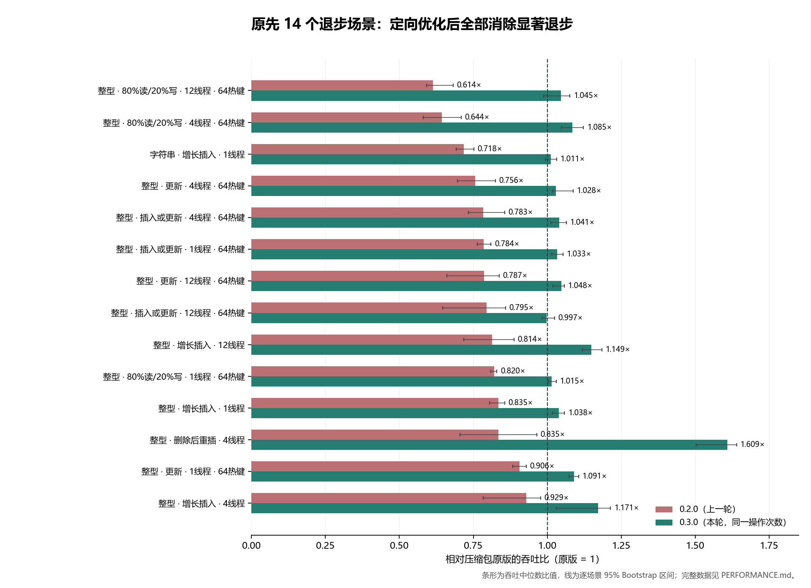

# 原版性能对齐报告：CSTL 0.3.0（2026-11-05）

## 本轮结果

参照对象是用户压缩包中的 CSTL 0.1.0 / parallel-hashmap Map。目标是逐场景消除退步，不能用平均收益抵消某个场景的损失。

- 完整 **48 场景、1584 个样本**：未发现统计显著的吞吐退步；47 个场景的中位吞吐高于原版，另一个为 **0.983x**，95% 区间 **[0.971, 1.085]**，包含 1。
- 上一轮 14 个退步场景按原来的 `ops_per_thread` 完整重放，**21 次/实现、882 个样本**，没有更改原始操作次数或插入总量。最小中位数比 **0.997x**，未出现显著退步。
- 另外加入接近分片增长阈值的 114672 键负载，**12 场景、324 个样本**，覆盖整型读/未命中/混合和字符串读。最小中位数比 **1.051x**。
- 以上 **74 组对照、2790 个样本** 的逐场景 95% Bootstrap 区间下限均高于 **0.964x**，全部通过“区间下限不低于原版 0.95x”的检查。5% 是本轮实际采用的测量容差，不能称为任意输入下数学意义的严格等速证明。
- 主矩阵 48 场景等权几何平均为原版 **1.127x（+12.7%）**；该值不混入重放和边界样本，避免重复加权。



图中新条形使用同一操作次数重放的 21 次数据；旧条形来自 0.2.0 原记录的 11 次数据。两轮分别和同批次原版比较，不合并跨批次绝对吞吐。

## 实际改动

1. 使用完整的 Boost `unordered_flat_map` 作为每片存储，恢复原版的 `ShardBits` 分片读写锁和局部扩容；没有用 std::unordered_map 替代 Boost，也没有退回 parallel-hashmap Map。
2. 通过透明预哈希查询复用用户 Hash 的结果，未触发扩容的单键操作只哈希一次；没有给每个元素增加哈希缓存字段。
3. Boost 默认每组 15 个槽，原版表的容量几何不同。对内部 Hash 单独启用 14/15 负载上限，使正常容量区间的增长阈值与原版对齐，避免相同元素数量下额外扩容；极小表保留 Boost 的原有规则。
4. 阅读两份源码并定位搬迁路径后，为使用标准分配器、满足平凡复制构造和平凡析构条件的元素采用平凡复制构造，并内联搬迁辅助函数。通过真正的构造操作建立对象生命周期，没有对未构造对象直接 memcpy。其他类型继续原来的移动/复制路径。

定制集中在 `include/boost/unordered/detail/foa/core.hpp`；官方原件、原始 SHA、修改后 SHA 和变化说明都保留在 `provenance/boost/` 与 `vendor_manifest.json`。未标记 Hash 保持官方负载上限和搬迁分派。探测规则、键值语义、锁内回调、异常释放锁和移动专属类型支持都经过测试。

## 原先14个退步场景：原参数重放

| 键 | 负载 | 线程 | 原 ops/线程 | 0.2/原版 | 0.3/原版 | 本轮95%区间 |
|---|---|---:|---:|---:|---:|---:|
| integer | 增长插入 | 1 | 1011820 | 0.835x | 1.038x | [1.018, 1.058] |
| integer | 更新（64热键） | 1 | 2000000 | 0.906x | 1.091x | [1.073, 1.106] |
| integer | 插入或更新（64热键） | 1 | 2000000 | 0.784x | 1.033x | [1.015, 1.053] |
| integer | 80%读/20%写（64热键） | 1 | 2000000 | 0.820x | 1.015x | [1.003, 1.030] |
| string | 增长插入 | 1 | 436930 | 0.718x | 1.011x | [0.994, 1.031] |
| integer | 删除后重插 | 4 | 177400 | 0.835x | 1.609x | [1.503, 1.639] |
| integer | 增长插入 | 4 | 208930 | 0.929x | 1.171x | [1.030, 1.213] |
| integer | 更新（64热键） | 4 | 391750 | 0.756x | 1.028x | [1.017, 1.087] |
| integer | 插入或更新（64热键） | 4 | 289710 | 0.783x | 1.041x | [1.011, 1.065] |
| integer | 80%读/20%写（64热键） | 4 | 454310 | 0.644x | 1.085x | [1.048, 1.122] |
| integer | 增长插入 | 12 | 65740 | 0.814x | 1.149x | [1.118, 1.184] |
| integer | 更新（64热键） | 12 | 132760 | 0.787x | 1.048x | [1.019, 1.058] |
| integer | 插入或更新（64热键） | 12 | 124550 | 0.795x | 0.997x | [0.982, 1.025] |
| integer | 80%读/20%写（64热键） | 12 | 120300 | 0.614x | 1.045x | [0.988, 1.077] |

## 内存检查

使用独立的 `cstl_memory` 程序，在容器仍存活且所有键值已验证后，直接查询当前进程的系统峰值 RSS；没有外部轮询遗漏退出前峰值的问题，也没有预生成键向量或复制快照。每种实现均用全新进程，3 次取中位数。该指标包含运行时、代码页及分配器保留空间，不能视为纯容器分配字节的精确统计。

| 键 | 模式 | 元素数 | 原版峰值RSS MiB | 0.3峰值RSS MiB | 0.3/原版 |
|---|---|---:|---:|---:|---:|
| integer | 预留后插入 | 200000 | 8.23 | 7.98 | 0.970x |
| integer | 预留后插入 | 1000000 | 38.00 | 36.01 | 0.948x |
| integer | 增长插入 | 200000 | 8.89 | 8.54 | 0.960x |
| integer | 增长插入 | 1000000 | 40.17 | 38.59 | 0.961x |
| string | 预留后插入 | 200000 | 23.45 | 22.84 | 0.974x |
| string | 预留后插入 | 1000000 | 132.09 | 127.11 | 0.962x |
| string | 增长插入 | 200000 | 24.02 | 23.47 | 0.977x |
| string | 增长插入 | 1000000 | 132.20 | 127.22 | 0.962x |

8 个场景峰值 RSS 均低于原版，下降约 2.3%–5.2%。空容器 `sizeof` 为原版 1024 字节、新版 1088 字节，固定多 64 字节；没有每元素字段增长。内存原始数据另含 Windows private-byte 差值，见 `results/memory.json`。探索阶段的外部轮询记录另存于 `results/exploratory/memory-polling.json`，不计入本节结论。

## 完整48场景

吞吐为百万次逻辑操作/秒。增长和预留插入的元素数为线程数 × ops/线程；其余行表示预置键数。比值大于 1 表示新版快于原版。

| 键 | 负载 | 线程 | 预置/最终元素 | 0.3 Mops/s | 原版 Mops/s | 0.3/原版 | 95%区间 |
|---|---|---:|---:|---:|---:|---:|---:|
| integer | 读命中 | 1 | 65536 | 16.51 | 15.28 | 1.080x | [1.048, 1.139] |
| integer | 读未命中 | 1 | 65536 | 19.16 | 17.53 | 1.093x | [1.084, 1.116] |
| integer | 更新 | 1 | 65536 | 16.60 | 15.37 | 1.080x | [1.055, 1.144] |
| integer | 插入或更新 | 1 | 65536 | 16.14 | 15.39 | 1.049x | [1.034, 1.116] |
| integer | 80%读/20%写 | 1 | 65536 | 16.16 | 15.23 | 1.061x | [1.038, 1.086] |
| integer | 删除后重插 | 1 | 65536 | 8.69 | 6.11 | 1.423x | [1.376, 1.459] |
| integer | 预留后插入 | 1 | 2000000 | 10.16 | 9.00 | 1.128x | [1.037, 1.166] |
| integer | 增长插入 | 1 | 2000000 | 8.86 | 8.32 | 1.065x | [1.037, 1.086] |
| integer | 更新 | 1 | 64 | 27.00 | 24.79 | 1.089x | [1.007, 1.120] |
| integer | 插入或更新 | 1 | 64 | 25.15 | 24.55 | 1.025x | [1.011, 1.067] |
| integer | 80%读/20%写 | 1 | 64 | 25.13 | 24.17 | 1.040x | [1.011, 1.059] |
| string | 读命中 | 1 | 65536 | 4.45 | 4.07 | 1.091x | [1.055, 1.128] |
| string | 更新 | 1 | 65536 | 4.34 | 3.97 | 1.092x | [1.048, 1.182] |
| string | 80%读/20%写 | 1 | 65536 | 4.27 | 3.57 | 1.197x | [1.104, 1.267] |
| string | 预留后插入 | 1 | 851110 | 3.90 | 3.75 | 1.039x | [1.003, 1.062] |
| string | 增长插入 | 1 | 669030 | 2.45 | 2.44 | 1.005x | [0.986, 1.040] |
| integer | 读命中 | 4 | 65536 | 24.88 | 21.14 | 1.177x | [1.081, 1.202] |
| integer | 读未命中 | 4 | 65536 | 26.28 | 26.72 | 0.983x | [0.971, 1.085] |
| integer | 更新 | 4 | 65536 | 19.37 | 16.62 | 1.165x | [1.109, 1.196] |
| integer | 插入或更新 | 4 | 65536 | 18.73 | 16.53 | 1.133x | [1.061, 1.159] |
| integer | 80%读/20%写 | 4 | 65536 | 21.94 | 18.30 | 1.199x | [1.099, 1.222] |
| integer | 删除后重插 | 4 | 65536 | 10.80 | 7.05 | 1.532x | [1.299, 1.657] |
| integer | 预留后插入 | 4 | 2958600 | 14.44 | 11.71 | 1.233x | [1.080, 1.310] |
| integer | 增长插入 | 4 | 2089640 | 9.69 | 8.29 | 1.170x | [1.140, 1.195] |
| integer | 更新 | 4 | 64 | 16.88 | 15.95 | 1.058x | [1.033, 1.083] |
| integer | 插入或更新 | 4 | 64 | 16.58 | 16.29 | 1.017x | [1.005, 1.062] |
| integer | 80%读/20%写 | 4 | 64 | 20.52 | 18.97 | 1.082x | [1.015, 1.127] |
| string | 读命中 | 4 | 65536 | 12.53 | 10.91 | 1.148x | [1.040, 1.214] |
| string | 更新 | 4 | 65536 | 9.91 | 8.66 | 1.145x | [1.083, 1.189] |
| string | 80%读/20%写 | 4 | 65536 | 11.74 | 9.97 | 1.178x | [1.133, 1.196] |
| string | 预留后插入 | 4 | 1096320 | 5.30 | 5.07 | 1.045x | [1.023, 1.064] |
| string | 增长插入 | 4 | 781400 | 3.09 | 3.03 | 1.021x | [0.964, 1.065] |
| integer | 读命中 | 12 | 65536 | 31.66 | 26.82 | 1.181x | [1.063, 1.267] |
| integer | 读未命中 | 12 | 65536 | 34.41 | 33.89 | 1.015x | [1.002, 1.146] |
| integer | 更新 | 12 | 65536 | 23.53 | 18.11 | 1.300x | [1.211, 1.317] |
| integer | 插入或更新 | 12 | 65536 | 22.47 | 18.85 | 1.192x | [1.127, 1.208] |
| integer | 80%读/20%写 | 12 | 65536 | 27.11 | 22.14 | 1.224x | [1.200, 1.282] |
| integer | 删除后重插 | 12 | 65536 | 12.51 | 7.01 | 1.785x | [1.375, 1.825] |
| integer | 预留后插入 | 12 | 3093720 | 15.88 | 14.14 | 1.123x | [1.062, 1.309] |
| integer | 增长插入 | 12 | 1926480 | 10.26 | 8.78 | 1.169x | [1.121, 1.191] |
| integer | 更新 | 12 | 64 | 17.73 | 17.23 | 1.029x | [0.993, 1.039] |
| integer | 插入或更新 | 12 | 64 | 17.20 | 16.95 | 1.015x | [0.968, 1.033] |
| integer | 80%读/20%写 | 12 | 64 | 21.43 | 21.37 | 1.003x | [0.988, 1.073] |
| string | 读命中 | 12 | 65536 | 21.65 | 19.55 | 1.107x | [1.073, 1.157] |
| string | 更新 | 12 | 65536 | 15.32 | 13.16 | 1.164x | [1.146, 1.205] |
| string | 80%读/20%写 | 12 | 65536 | 17.83 | 15.49 | 1.151x | [1.130, 1.191] |
| string | 预留后插入 | 12 | 1119600 | 5.61 | 5.20 | 1.078x | [1.040, 1.088] |
| string | 增长插入 | 12 | 603600 | 3.03 | 2.81 | 1.080x | [1.040, 1.108] |

## 增长阈值附近补测

114672 = 16 × 7167，接近分片正常容量区间的增长上限。插入后实际分布可能使部分片先增长，未强行固定每片占用。每线程 500000 次，9 次/实现。

| 键 | 负载 | 线程 | 0.3/原版 | 95%区间 |
|---|---|---:|---:|---:|
| integer | 读命中 | 1 | 1.111x | [0.966, 1.286] |
| integer | 读未命中 | 1 | 1.229x | [1.196, 1.253] |
| integer | 80%读/20%写 | 1 | 1.052x | [0.996, 1.117] |
| string | 读命中 | 1 | 1.106x | [1.094, 1.187] |
| integer | 读命中 | 4 | 1.144x | [1.077, 1.219] |
| integer | 读未命中 | 4 | 1.062x | [1.002, 1.113] |
| integer | 80%读/20%写 | 4 | 1.174x | [1.077, 1.232] |
| string | 读命中 | 4 | 1.095x | [1.025, 1.272] |
| integer | 读命中 | 12 | 1.209x | [1.086, 1.263] |
| integer | 读未命中 | 12 | 1.051x | [1.014, 1.157] |
| integer | 80%读/20%写 | 12 | 1.225x | [1.161, 1.287] |
| string | 读命中 | 12 | 1.081x | [1.044, 1.146] |

## 方法与复现

Windows x64，12 逻辑处理器，MSVC 19.44.35213，C++17，Release `/O2 /Ob2 /DNDEBUG`。同一可执行文件包含原版、直接 Boost concurrent_flat_map 控制和新版；都使用相同 Key/T 与 std::hash。每轮随机交错，保留所有样本并检查操作数、值总和与插入结果。配对 Bootstrap 按轮重采样 2000 次，使用中位吞吐比的逐场景区间。无 CPU 亲和性/频率固定；吞吐测试期间不并行执行本任务的构建、单元或内存测试。

本轮以原包原版为目标。直接 Boost concurrent_flat_map 的部分大表多线程负载仍更快；它的全部数据保留在 CSV/JSON。不能把此报告解释为“任何场景都优于 Boost 原生并发表”。没有改变原版对照的源码、工作量、正确性规则或统计口径。

```sh
python tools/benchmark.py --exe build-parity-release/cstl_compare.exe --output results --repeats 11 --target 0.2
python tools/benchmark.py --exe build-parity-release/cstl_compare.exe --output results/boundary --plan results/boundary-plan.json --repeats 9
python tools/memory_benchmark.py --exe build-parity-release/cstl_memory.exe --output results/memory.json
```

也可直接运行 `python tools/replay_regressions.py --exe build-parity-release/cstl_compare.exe` 重放全部 14 项。

逐项验收：`python tools/check_performance.py results/summary.json results/replay-original-regressions/summary.json results/boundary/summary.json`。该检查同时要求区间下限不低于 0.95，以及区间上限不低于 1（不接受已经显著落后的结果）。

重放旧退步场景：`--plan results/v0.2.0/summary.json --repeats 21` 并用 `--case 键类型:负载:线程:预置键数` 选择上表 14 个旧场景；操作次数由计划原样读取，不校准或四舍五入。完整参数、二进制/源码 SHA 和所有样本在各目录的 environment.json、raw.csv、summary.json。Linux/macOS 去掉 .exe，多配置生成器加 Release/ 子目录。

原包 legacy benchmark 也分别运行于原版和新版的 1/4/12 线程，验证结果在 `results/legacy/`，不混入以上几何平均。0.2.0 旧数据和报告保存在 `results/v0.2.0/`。

## 结论适用范围

本轮已经消除先前发现的 14 个明显退步，并在新增边界负载中未发现显著退步。有限实验不能承诺任何硬件、键类型、分布、线程数或业务中永远严格等速；5% 容差检查是逐场景检查，不是全部场景联合95%保证。未测逐操作 P50/P99 或长期业务耐久。完整功能及跨平台验证见 VALIDATION.md。
